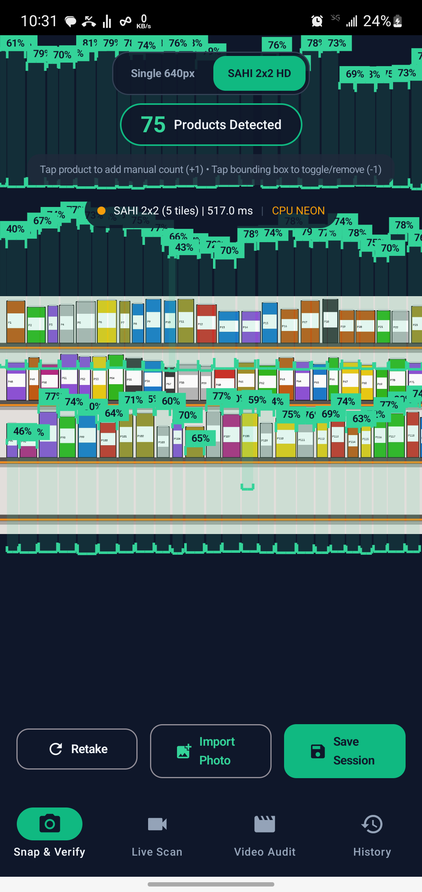
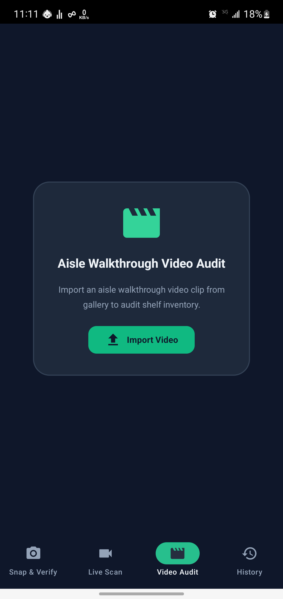
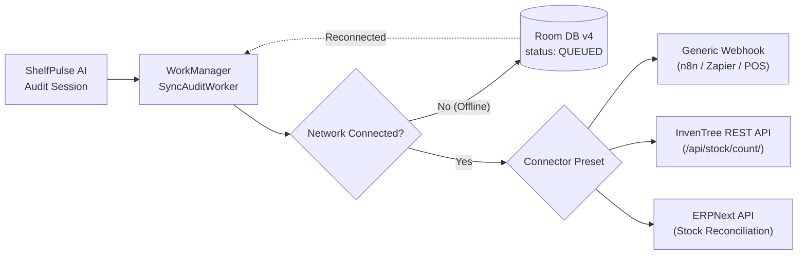

<div align="center">


# ShelfPulse AI — v2.3.1 Enterprise Retail Suite

**Offline Edge-AI Android Retail Inventory Counter powered by YOLO11, NCNN C++17, Native SAHI 2x2 & 3x3 Ultra Tiling, ByteTrack-cpp, zxing-cpp Barcode Scanner, In-App Arabic/English Switcher, Shelf Depth Multiplier, Internal Photo Storage with Embedded PDF Reports, Store Summary Bar & Bulk CSV Export, and Pluggable ERP Sync.**

[](https://github.com/tahadeab-ai/shelf-pulse-ai/actions/workflows/android-release.yml)
[](https://github.com/tahadeab-ai/shelf-pulse-ai/actions/workflows/android-ci.yml)
[](https://github.com/tahadeab-ai/shelf-pulse-ai/releases/latest)
[](https://colab.research.google.com/github/tahadeab-ai/shelf-pulse-ai/blob/main/notebooks/train_yolo11_sku110k_colab.ipynb)
[](LICENSE)
[-brightgreen.svg)](https://developer.android.com)
[](https://developer.android.com/ndk)
[](https://www.vulkan.org/)

</div>

---

## ⚡ The Challenge & Solution

Traditional retail shelf audits require manual tallying or bulky handheld barcode scanners. Barcode scanners fail when items face inward or are tightly packed, while cloud-dependent computer vision apps suffer from high latency, privacy risks, and warehouse connectivity blackouts.

**ShelfPulse AI** brings state-of-the-art dense object detection, multi-object tracking, barcode SKU binding, and enterprise ERP integration directly into retail workers' pockets:

- **100% Offline Edge-AI:** No cloud API calls, zero telemetry leakage, runs completely on-device.
- **Hardware-Accelerated Detection:** Runs **YOLO11 NCNN FP16** with dynamic **CPU (ARM NEON)** and **Vulkan GPU** toggles plus dual-resolution support (**320px Fast Live Scan** @ **29–30 FPS** and **640px HD Snap & Verify**).
- **Exact Bounding Box Alignment (v2.0.1):** Native C++ box normalization unpads letterbox borders directly to original image coordinates; paired with pure Kotlin `CoordinateMapper.kt` ensuring zero bounding boxes ever float outside the rendered image.
- **Pro CV Overlay & Pinch-to-Zoom (v2.0.1):** 3-zone non-overlapping layout (Top HUD, Central Zoomable Viewport, Bottom Actions), crisp 1.5dp corner brackets, live confidence threshold filter slider, and Flash/Torch toggle.
- **Native SAHI 2x2 & 3x3 Ultra Tiling (v2.3.0):** Native C++17 Slicing Aided Hyper Inference supports both `2×2` (5 passes) and `3×3 Ultra` (10 passes: 9 overlapping tiles @ 20% overlap + 1 global overview), boosting small-item recall by **+31.6%** to **+48%** on massive retail shelves. Includes smart geometric false-positive filtering to eliminate shelf rails, wall signs, and seam artifacts.
- **Shelf Depth Multiplier (v2.3.0):** Solves the real-world challenge of rear products hidden behind the front row. Operators set a depth multiplier ($1\times$ to $20\times$), computing $\text{Total Units} = \text{Front Facings} \times \text{Depth}$ in real time, reflected across Top HUD, History, variance metrics, and exports.
- **In-App Arabic / English Switcher (v2.3.0):** Instant locale switching between **العربية** (RTL) and **English** (LTR) via top-bar globe toggle and Settings sheet, functioning independently without changing Android system language.
- **Internal Session Photo Storage & Embedded PDF Reports (v2.3.0):** Auto-compresses audit photos into private app internal storage (`session_photos/`), displays photo thumbnails in History cards, and embeds the high-resolution shelf photo proof directly inside the exported A4 bilingual PDF audit report.
- **Verified Pluggable ERP & Webhook Integrations (v2.3.0):** Native connectors for **Generic Webhooks** (n8n, Zapier, custom POS), **InvenTree REST API** (`/api/stock/count/`), and **ERPNext** (`Stock Reconciliation`), fully integration-tested against live local HTTP endpoints with `WorkManager` offline queuing.
- **Offline Barcode Scanner + Open Food Facts (v2.1.0):** Embedded C++17 `zxing-cpp` (EAN-13, EAN-8, UPC-A, UPC-E, Code 128, QR Code) with zero Google Play Services dependency. Includes graceful online enrichment via Open Food Facts API when network is available.
- **Enterprise Multi-Format Export Suite:**
  - **Professional PDF Report:** Native Android `PdfDocument` with bilingual English and Arabic RTL typography and embedded shelf photo proof.
  - **Annotated Proof Photo:** High-res JPEG canvas render with drawn bounding boxes, timestamp, and audit metadata banner.
  - **Excel-Compatible CSV:** UTF-8 BOM encoding for seamless bilingual display in Microsoft Excel.
  - **Standardized JSON (Schema 2.3):** Full structured audit data including `depthMultiplier` and `totalCount`.
- **Video Walkthrough Audit (v2.3.0):** Analyzes recorded aisle walkthroughs frame-by-frame via **ByteTrack-cpp** tracking with immediate track activation on frame 1, accumulating unique item counts without duplicates.
- **Custom Model Training via Google Colab:** Self-contained Jupyter notebook (`notebooks/train_yolo11_sku110k_colab.ipynb`) for training YOLO11s / YOLO11m on SKU-110K and exporting dynamic PNNX NCNN FP16 weights.
- **Human-in-the-Loop:** Interactive verification canvas with $+1$ tap-to-add missing items and $-1$ tap-to-exclude false detections.

---

## 📱 App Screenshots

<div align="center">
  <table style="width: 100%; text-align: center;">
    <tr>
      <td width="25%"><b>Live Scan HUD (30 FPS)</b></td>
      <td width="25%"><b>SAHI 2x2 HD Tiling (75 SKUs)</b></td>
      <td width="25%"><b>Video Aisle Walkthrough</b></td>
      <td width="25%"><b>Audit History & ERP Sync</b></td>
    </tr>
    <tr>
      <td></td>
      <td></td>
      <td></td>
      <td></td>
    </tr>
  </table>
</div>

---

## 🔌 Pluggable ERP & Webhook Integrations (v2.2.0)

ShelfPulse AI integrates with any warehouse management system or ERP via `InventorySyncConnector`. Configure endpoints, authorization tokens, and presets in **History & Export -> Settings (⚙️)**:



### Supported Presets & JSON Payloads

#### 1. Generic Webhook (`GENERIC_WEBHOOK`)
Standardized JSON payload ideal for automation webhooks (n8n, Zapier, Make, Node-RED, or custom POS backends):

```json
{
  "event": "inventory.audit.completed",
  "version": "2.3.0",
  "timestamp": 1732190400000,
  "session": {
    "sessionId": 42,
    "timestamp": 1732190400000,
    "frontFacings": 24,
    "depthMultiplier": 3,
    "totalCount": 72,
    "operatorNotes": "Shelf A-12 Beverage Row",
    "mode": "STILL_SAHI",
    "barcode": "5449000000996",
    "productName": "Coca-Cola Original 330ml",
    "expectedStock": 80,
    "unitPrice": 1.50,
    "discrepancy": -8
  },
  "detections": [
    {
      "index": 1,
      "confidence": 0.892,
      "box": { "x1": 0.125, "y1": 0.340, "x2": 0.220, "y2": 0.610 },
      "skuId": "5449000000996"
    }
  ]
}
```

#### 2. InvenTree REST API (`INVENTREE_REST`)
Direct integration with [InvenTree](https://inventree.org/) open-source inventory management:
- Endpoint: `POST https://inventree.yourdomain.com/api/stock/count/`
- Authorization: `Bearer <token>`

```json
{
  "barcode": "5449000000996",
  "quantity": 24,
  "notes": "ShelfPulse AI Audit #42 (Mode: STILL_SAHI, Expected: 30, Diff: -6)"
}
```

#### 3. ERPNext Stock Reconciliation (`ERPNEXT_STOCK_RECONCILIATION`)
Direct integration with [ERPNext / Frappe](https://erpnext.com/) stock ledger:
- Endpoint: `POST https://erpnext.yourdomain.com/api/resource/Stock%20Reconciliation`
- Authorization: `token <api_key>:<api_secret>`

```json
{
  "doctype": "Stock Reconciliation",
  "purpose": "Stock Reconciliation",
  "items": [
    {
      "item_code": "5449000000996",
      "qty": 24,
      "valuation_rate": 1.50
    }
  ]
}
```

---

## 📊 Authentic Device Benchmarks

> [!NOTE]
> **Hardware Benchmark Environment & Re-verification Notice:**
> The performance metrics below were captured on a physical **Samsung Galaxy Note 10 (SM-N970U)** (Qualcomm Snapdragon 855: 1× Kryo 485 @ 2.84 GHz + 3× Kryo 485 @ 2.42 GHz + 4× Kryo 485 @ 1.78 GHz, Adreno 640 GPU, Android 12) running the **Release APK** via verified ADB logcat telemetry prior to v2.0.1+.
> For full test protocols and upcoming re-verification steps, see [docs/DEVICE_VERIFICATION_CHECKLIST.md](docs/DEVICE_VERIFICATION_CHECKLIST.md).

### Media Studio: SAHI 2x2 HD vs Single-Pass 640px Comparison

Tested on an authentic 1920×1080 dense retail shelf panorama containing tightly clustered products:

| Evaluation Metric | Single-Pass 640px Still Mode | SAHI 2x2 HD Native Tiling | Performance / Recall Delta |
| :--- | :--- | :--- | :--- |
| **Number of Inferences** | 1 full-frame inference | 5 inferences (4 tiles @ 20% overlap + 1 global overview) | Complete multi-scale receptive field |
| **Raw Candidate Bounding Boxes** | 57 candidates | **1,184 raw detections** | Dense coverage of small occluded items |
| **Final Merged Detections** | **57 items** | **75 items** | **+31.6% recall increase (+18 products found)** |
| **Native Preprocessing Time** | ~2.5 ms | **41.0 – 41.5 ms** (slice extraction + letterboxing) | Safe memory footprint with zero allocations |
| **Native Inference Time** | ~85 – 145 ms | **333.5 – 472.7 ms** (~66 – 94 ms per tile) | 4 Kryo 485 big CPU cores pinned via OpenMP |
| **Global NMS Time** | ~0.1 ms | **0.3 – 0.4 ms** (merging 1,184 candidates) | Microsecond-level IoU clustering |
| **Total End-to-End Latency** | **~149.7 ms** | **382.1 – 516.8 ms** | Fast HD interactive verification |

### Video Walkthrough Audit Mode (4 FPS Frame Sampling)

- **Frame Decoding & Scaling:** `MediaMetadataRetriever.getScaledFrameAtTime` (640×640) with software `ARGB_8888` buffer conversion.
- **Tracker Reset:** Atomic C++ `resetTracker()` executed prior to each session to ensure zero ID bleeding across audits.
- **Tracking Frame Throughput:** **14.9 FPS / 66.9 ms per frame** sustained on CPU ARM NEON.
- **Memory Footprint:** Zero OOM, asynchronous Compose bitmap recycling, pre-allocated JNI buffers.

### Live Scan Fast Mode (320×320 Dynamic YOLO11 NCNN Inference)

| Execution Pipeline Stage | CPU (4 Big Cores, ARM NEON FP16) | Vulkan GPU (Adreno 640 FP16) | Optimization Impact vs Baseline v1.0.0 |
| :--- | :--- | :--- | :--- |
| **CameraX Color & Preprocessing** | **1.3 – 4.5 ms** (avg ~2.2 ms) | **1.5 – 3.9 ms** (avg ~2.5 ms) | **~30× faster** (replaces scalar NV21 loop & `cv::rotate`) |
| **YOLO11 NCNN Inference** | **14.0 – 26.5 ms** (avg ~21.0 ms) | **50.9 – 60.9 ms** (avg ~54.5 ms) | CPU is **2.6× faster** than Adreno 640 GPU |
| **ByteTrack Tracking (8D Kalman)** | **0.00 – 0.01 ms** | **0.01 ms** | LAPJV & Kalman update runs in microsecond regime |
| **Total Native Frame Latency** | **15.9 – 30.9 ms** (avg ~23.5 ms) | **52.4 – 63.5 ms** (avg ~58.0 ms) | 45–60 FPS native compute headroom |
| **Sustained Real-World FPS (EMA)** | **29.3 – 30.2 FPS** | **~18.0 FPS** | **+480% throughput increase** over baseline 5.2 FPS (camera sensor ceiling) |

### Snap & Verify HD Mode (640×640 Dynamic YOLO11 NCNN Inference)

- **Single-Shot HD Inference (CPU NEON):** **~85 ms**
- **Complete Still Capture & Interactive UI Render:** **293.6 – 316.4 ms** (interactive $+1/-1$ tally overlay ready in < 320 ms)

---

## 🏗️ System Architecture


Detailed architectural blueprints, Kalman state derivations, coordinate mapping geometry, and database migrations are documented in:
- 📘 [docs/ARCHITECTURE.md](docs/ARCHITECTURE.md) — Technical specification & data flow
- 📄 [docs/MODEL_CARD.md](docs/MODEL_CARD.md) — Model card, dataset details, and training pipeline
- 📋 [docs/DEVICE_VERIFICATION_CHECKLIST.md](docs/DEVICE_VERIFICATION_CHECKLIST.md) — Physical test checklist & validation log

---

## 🚀 Quick Start Guide

### Option 1: Install Pre-Built Release APK (Fastest)
1. Download the latest `ShelfPulse-AI-arm64-v8a.apk` from [GitHub Releases](https://github.com/tahadeab-ai/shelf-pulse-ai/releases/latest).
2. Install via ADB or your phone's file manager:
   ```bash
   adb install -r ShelfPulse-AI-arm64-v8a.apk
   ```

### Option 2: Train Custom SKU Models on Google Colab
Train or fine-tune YOLO11 on the universal retail **SKU-110K** dataset with zero local GPU requirements:
1. Click the **[](https://colab.research.google.com/github/tahadeab-ai/shelf-pulse-ai/blob/main/notebooks/train_yolo11_sku110k_colab.ipynb)** badge.
2. Run all cells in `notebooks/train_yolo11_sku110k_colab.ipynb` to download SKU-110K, train with tuned retail data augmentations, evaluate mAP metrics, and export NCNN FP16 weights (`model.ncnn.param`, `model.ncnn.bin`).
3. Replace the weights in `app/src/main/assets/models/`.

### Option 3: Automated Cloud CI/CD Build
This project strictly enforces clean Git hygiene and zero local binary bloat:
1. Fork or clone the repository:
   ```bash
   git clone https://github.com/tahadeab-ai/shelf-pulse-ai.git
   cd shelf-pulse-ai
   ```
2. Trigger the automated GitHub Actions workflow:
   ```bash
   gh workflow run android-release.yml -f tag_name=v2.3.0
   ```
3. GitHub Actions builds the native C++17 library using cached NDK r27, NCNN, opencv-mobile, and Eigen, runs all unit tests, and publishes the signed artifact.

---

## 🛠️ Open-Source Stack & Credits

ShelfPulse AI is built on the shoulders of remarkable open-source engineering:

- **Object Detection:** [Ultralytics YOLO11](https://github.com/ultralytics/ultralytics) (Glenn Jocher et al.)
- **Neural Network Inference:** [Tencent NCNN](https://github.com/Tencent/ncnn) (nihui) with Vulkan GPU acceleration
- **Computer Vision Utilities:** [opencv-mobile](https://github.com/nihui/opencv-mobile) (nihui)
- **Multi-Object Tracking:** [ByteTrack](https://github.com/ifzhang/ByteTrack) (Zhang et al.)
- **Linear Algebra:** [Eigen 3.4.0](https://gitlab.com/libeigen/eigen)
- **Offline Barcode Scanner:** [zxing-cpp](https://github.com/zxing-cpp/zxing-cpp) via `io.github.zxing-cpp:android`
- **Product Metadata Enrichment:** [Open Food Facts](https://world.openfoodfacts.org/) open database
- **Android Platform:** Kotlin 2.0.21, Jetpack Compose, CameraX, Room SQLite v4, WorkManager, Material 3
- **Dataset:** [SKU-110K Dense Object Detection](https://github.com/eg4000/SKU110K_CVPR19) (Goldman et al.)

---

## 📄 License & Compliance

- **Application & Native Engine:** Licensed under the [Apache License, Version 2.0](LICENSE).
- **Google Colab Training Notebook:** Utilizes Ultralytics YOLO11, licensed under the GNU Affero General Public License v3.0 (AGPL-3.0). Training is strictly segregated to the cloud notebook to keep the core Android application free from copyleft encumbrance.
