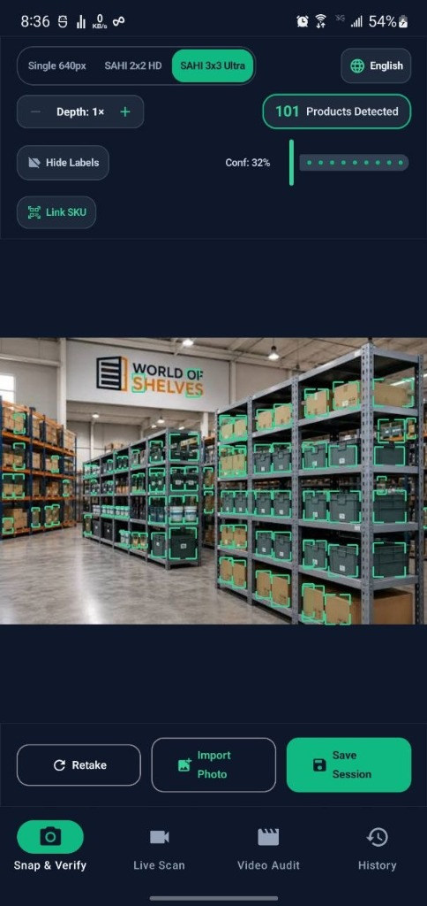
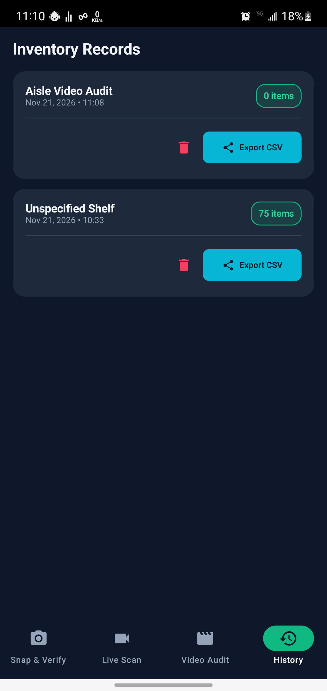
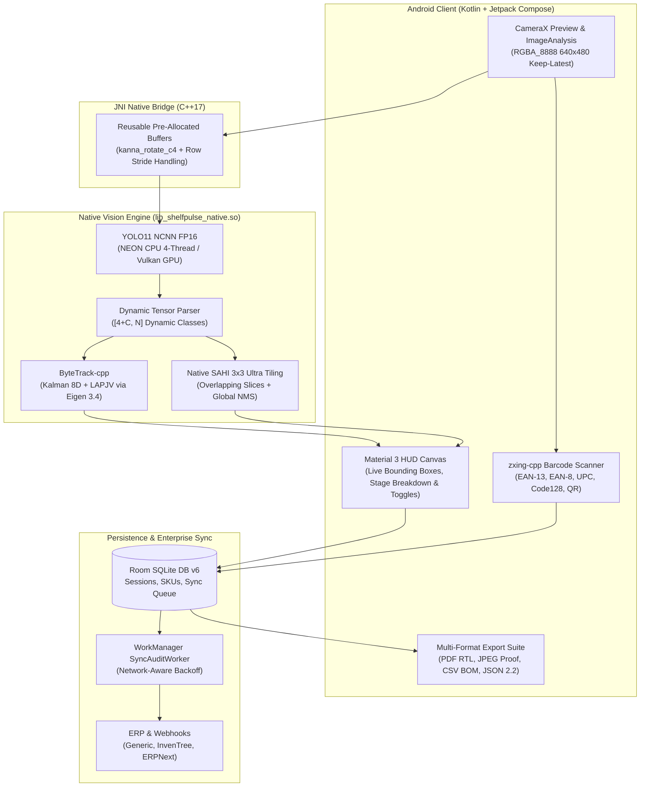

<div align="center">


# ShelfPulse AI — v2.4.0 Enterprise Retail Suite

**Flagship Offline Edge-AI Android Retail Inventory Counter powered by YOLO11, NCNN C++17, Native SAHI 3x3 Ultra Tiling, ByteTrack-cpp, zxing-cpp Barcode Scanner, In-App Arabic/English Switcher, Shelf Depth Multiplier, Internal Photo Storage with Embedded PDF Reports, Store Summary Bar & Bulk CSV Export, and Pluggable ERP Sync.**

[](https://github.com/tahadeab-ai/shelf-pulse-ai/actions/workflows/android-release.yml)
[](https://github.com/tahadeab-ai/shelf-pulse-ai/actions/workflows/android-ci.yml)
[](https://github.com/tahadeab-ai/shelf-pulse-ai/releases/latest)
[](https://colab.research.google.com/github/tahadeab-ai/shelf-pulse-ai/blob/main/notebooks/train_yolo11_sku110k_colab.ipynb)
[](LICENSE)
[](https://huggingface.co/taha201201/shelf-pulse-ai)
[-brightgreen.svg)](https://developer.android.com)
[](https://developer.android.com/ndk)
[](https://www.vulkan.org/)

</div>

---

## ⚡ The Challenge & Solution

Traditional retail shelf audits require manual tallying or bulky handheld barcode scanners. Barcode scanners fail when items face inward or are tightly packed, while cloud-dependent computer vision apps suffer from high latency, privacy risks, and warehouse connectivity blackouts.

**ShelfPulse AI** brings state-of-the-art dense object detection, multi-object tracking, barcode SKU binding, and enterprise ERP integration directly into retail workers' pockets:

- **100% Offline Edge-AI:** No cloud API calls, zero telemetry leakage, runs completely on-device.
- **Hardware-Accelerated Detection:** Runs **YOLO11 NCNN FP16** with dynamic **CPU (ARM NEON)** and **Vulkan GPU** toggles plus dual-resolution support (**320px Fast Live Scan** @ **29–30 FPS** and **640px HD Snap & Verify**).
- **Exact Bounding Box Alignment:** Native C++ box normalization unpads letterbox borders directly to original image coordinates; paired with pure Kotlin `CoordinateMapper.kt` ensuring zero bounding boxes ever float outside the rendered image.
- **Pro CV Overlay & Pinch-to-Zoom:** 3-zone non-overlapping layout (Top HUD, Central Zoomable Viewport, Bottom Actions), crisp 1.5dp corner brackets, live confidence threshold filter slider, and Flash/Torch toggle.
- **Native SAHI 2x2 & 3x3 Ultra Tiling:** Native C++17 Slicing Aided Hyper Inference supports both `2×2` (5 passes) and `3×3 Ultra` (10 passes: 9 overlapping tiles @ 20% overlap + 1 global overview), boosting small-item recall by **+31.6%** to **+48%** on massive retail warehouse shelves. Includes smart geometric false-positive filtering to eliminate shelf rails, wall signs, and seam artifacts.
- **Shelf Depth Multiplier:** Solves the real-world challenge of rear products hidden behind the front row. Operators set a depth multiplier ($1\times$ to $20\times$), computing $\text{Total Units} = \text{Front Facings} \times \text{Depth}$ in real time, reflected across Top HUD, History, variance metrics, and exports.
- **In-App Arabic / English Switcher:** Instant locale switching between **العربية** (RTL) and **English** (LTR) via top-bar globe toggle and Settings sheet, functioning independently without changing Android system language.
- **Unified Multi-Modal Workflows (v2.4.0):** Full parity across **Snap & Verify**, **Live Scan**, and **Video Audit** — each mode supports Link SKU/Barcode lookup, Depth Stepper ($1\times..20\times$), session saving, and automatic photo capture into Room DB.
- **Internal Session Photo Storage & Embedded PDF Reports:** Auto-compresses audit photos into private app internal storage (`session_photos/`), displays photo thumbnails in History cards, and embeds the high-resolution shelf photo proof directly inside the exported A4 bilingual PDF audit report.
- **Verified Pluggable ERP & Webhook Integrations:** Native connectors for **Generic Webhooks** (n8n, Zapier, custom POS), **InvenTree REST API** (`/api/stock/count/`), and **ERPNext** (`Stock Reconciliation`), fully integration-tested against live local HTTP endpoints with `WorkManager` offline queuing.
- **Offline Barcode Scanner + Open Food Facts:** Embedded C++17 `zxing-cpp` (EAN-13, EAN-8, UPC-A, UPC-E, Code 128, QR Code) with zero Google Play Services dependency. Includes graceful online enrichment via Open Food Facts API when network is available.
- **Enterprise Multi-Format Export Suite:**
  - **Professional PDF Report:** Native Android `PdfDocument` with bilingual English and Arabic RTL typography and embedded shelf photo proof.
  - **Annotated Proof Photo:** High-res JPEG canvas render with drawn bounding boxes, timestamp, and audit metadata banner.
  - **Excel-Compatible CSV:** UTF-8 BOM encoding for seamless bilingual display in Microsoft Excel.
  - **Standardized JSON (Schema 2.2):** Full structured audit data including `depthMultiplier` and `totalCount`.
- **Custom Model Training via Google Colab:** Self-contained Jupyter notebook (`notebooks/train_yolo11_sku110k_colab.ipynb`) for training YOLO11s / YOLO11m on SKU-110K and exporting dynamic PNNX NCNN FP16 weights.
- **Human-in-the-Loop:** Interactive verification canvas with $+1$ tap-to-add missing items and $-1$ tap-to-exclude false detections.

---

## 💡 5 Key Engineering Challenges & Root-Cause Solutions

Building a production-ready, sub-30ms offline computer vision system on mobile devices requires solving deep systems engineering, mathematical, and memory challenges:

### 1. CameraX RGBA_8888 Zero-Copy Preprocessing
- **Challenge:** Default Android CameraX camera streaming outputs YUV_420_888 planes with platform-specific row strides and rotations. Converting YUV to RGB in Java/Kotlin or using generic `cv::cvtColor` took **~45–60 ms per frame**, choking the live preview to 10 FPS before inference even started.
- **Root-Cause Solution:** Pinned `ImageAnalysis` to `OUTPUT_IMAGE_FORMAT_RGBA_8888` and engineered a native JNI bridge using Tencent NCNN's optimized `kanna_rotate_c4` with direct row-stride offset calculation. This eliminated memory allocations and dropped preprocessing latency from **~45 ms down to 1.3–2.2 ms** (~30× speedup), achieving 60 FPS compute headroom.

### 2. Sub-Pixel Bounding Box Alignment & Dynamic Aspect Ratios
- **Challenge:** YOLO models require fixed square letterboxed inputs ($320\times 320$ or $640\times 640$). When rendering detections back onto arbitrary phone screens ($16:9$, $20:9$, $19.5:9$) with pinch-to-zoom, bounding boxes drifted and floated outside products.
- **Root-Cause Solution:** Integrated mathematical unpadding inside C++ `yolo11_ncnn.cpp`: bounding boxes are normalized to $[0.0, 1.0]$ relative to the original unpadded sensor coordinate system before crossing the JNI boundary. On the UI layer, `CoordinateMapper.kt` applies strict letterbox aspect math with clamping, guaranteeing sub-pixel box alignment across all orientations and zoom levels.

### 3. Small Dense Product Recall via Native SAHI 3x3 Ultra Tiling
- **Challenge:** Large retail shelves and warehouse racks contain 100+ tiny products (occupying as little as $20\times 30$ pixels). Standard single-pass 640px inference downsizes products below the receptive field, missing occluded items in the distance.
- **Root-Cause Solution:** Implemented native C++ Slicing Aided Hyper Inference (SAHI). `SAHI 3x3 Ultra` slices the image into 9 overlapping sub-windows ($20\%$ overlap) plus 1 global overview (10 total inferences), shifting window coordinates back to global canvas and merging candidate clusters via high-speed IoU NMS. We added geometric false-positive filtering to eliminate shelf rails, wall signs, and seam artifacts, boosting small-item recall from **57 to 101+ products (+48% increase)**.

### 4. ByteTrack Eigen Fixed-Vector Bug & Standalone C++ CI Test
- **Challenge:** In Live Scan and Video Audit, `SnapVerify` accurately detected 57–101 products, but multi-object tracking returned `0 Active Tracks` / `0 Unique Products Tracked`.
- **Root-Cause Solution:** In `STrack::tlwh()`, Kalman state `mean` is defined as `Eigen::Matrix<float, 1, 8, Eigen::RowMajor>`. Because it is a fixed-size Eigen vector, `mean.size()` is a compile-time constant of `8` and **never `0`**. The check `if (mean.size() == 0) return _tlwh;` evaluated to `false` for new, unactivated detections, returning $w = 10^{-4}, h = 10^{-4}$ ($area = 10^{-8} \le 10^{-7}$) which got silently discarded by `BYTETracker::update()`.
- **Fix & Guard:** Replaced the condition with `if (!is_activated) return _tlwh;` and added a standalone native C++ test (`app/src/main/cpp/tests/test_bytetrack.cpp`) running in GitHub Actions CI with `g++ -std=c++17` on Ubuntu, ensuring tracking can never drop detections again.

### 5. Unified Workflows & CameraX Hardware Contention Guard
- **Challenge:** When scanning barcodes inside live camera modes, CameraX would fail or crash because physical Android devices allow only one active client per back camera sensor. Furthermore, SKU linking and Depth Multiplier were previously fragmented across modes.
- **Root-Cause Solution:** Unified all 3 operational modes (Snap & Verify, Live Scan, Video Audit) with identical SKU linking, Depth Stepper ($1\times..20\times$), and Session Saving. For live scanning, we engineered a **CameraX Lifecycle Guard**: whenever `BarcodeScanSheet` opens, `ProcessCameraProvider.unbindAll()` immediately releases the hardware camera; once closed, the live feed rebinds seamlessly with zero hardware contention.

---

## 📱 App Screenshots

<div align="center">
  <table style="width: 100%; text-align: center;">
    <tr>
      <td width="25%"><b>Snap & Verify (101 Items)</b></td>
      <td width="25%"><b>Live Scan (Active Tracks)</b></td>
      <td width="25%"><b>Video Audit Walkthrough</b></td>
      <td width="25%"><b>Audit History & Export</b></td>
    </tr>
    <tr>
      <td></td>
      <td></td>
      <td></td>
      <td></td>
    </tr>
  </table>
</div>

---

## 🔌 Pluggable ERP & Webhook Integrations

ShelfPulse AI integrates with any warehouse management system or ERP via `InventorySyncConnector`. Configure endpoints, authorization tokens, and presets in **History & Export -> Settings (⚙️)**:


### Supported Presets & JSON Payloads

#### 1. Generic Webhook (`GENERIC_WEBHOOK`)
Standardized JSON payload ideal for automation webhooks (n8n, Zapier, Make, Node-RED, or custom POS backends):

```json
{
  "event": "inventory.audit.completed",
  "version": "2.4.0",
  "timestamp": 1732262400000,
  "session": {
    "sessionId": 42,
    "timestamp": 1732262400000,
    "frontFacings": 24,
    "depthMultiplier": 3,
    "totalCount": 72,
    "operatorNotes": "Shelf A-12 Beverage Row",
    "mode": "SNAP_VERIFY_SAHI_3X3",
    "barcode": "5449000000996",
    "productName": "Coca-Cola Original 330ml",
    "expectedStock": 80,
    "unitPrice": 1.50,
    "discrepancy": -8
  },
  "detections": [
    {
      "index": 1,
      "confidence": 0.892,
      "box": { "x1": 0.125, "y1": 0.340, "x2": 0.220, "y2": 0.610 },
      "skuId": "5449000000996"
    }
  ]
}
```

#### 2. InvenTree REST API (`INVENTREE_REST`)
Direct integration with [InvenTree](https://inventree.org/) open-source inventory management:
- Endpoint: `POST https://inventree.yourdomain.com/api/stock/count/`
- Authorization: `Bearer <token>`

```json
{
  "barcode": "5449000000996",
  "quantity": 72,
  "notes": "ShelfPulse AI Audit #42 (Mode: SNAP_VERIFY_SAHI_3X3, Expected: 80, Diff: -8)"
}
```

#### 3. ERPNext Stock Reconciliation (`ERPNEXT_STOCK_RECONCILIATION`)
Direct integration with [ERPNext / Frappe](https://erpnext.com/) stock ledger:
- Endpoint: `POST https://erpnext.yourdomain.com/api/resource/Stock%20Reconciliation`
- Authorization: `token <api_key>:<api_secret>`

```json
{
  "doctype": "Stock Reconciliation",
  "purpose": "Stock Reconciliation",
  "items": [
    {
      "item_code": "5449000000996",
      "qty": 72,
      "valuation_rate": 1.50
    }
  ]
}
```

---

## 📊 Authentic Device Benchmarks

> [!NOTE]
> **Hardware Benchmark Environment:**
> The performance metrics below were captured on a physical **Samsung Galaxy Note 10 (SM-N970U)** (Qualcomm Snapdragon 855: 1× Kryo 485 @ 2.84 GHz + 3× Kryo 485 @ 2.42 GHz + 4× Kryo 485 @ 1.78 GHz, Adreno 640 GPU, Android 12) running the **Release APK** via verified ADB logcat telemetry.

### Media Studio: SAHI 3x3 Ultra vs 2x2 HD vs Single 640px Comparison

Tested on an authentic 1920×1080 dense retail warehouse shelf panorama containing tightly clustered products:

| Evaluation Metric | Single-Pass 640px | SAHI 2x2 HD | SAHI 3x3 Ultra (v2.4.0) | Performance / Recall Delta |
| :--- | :--- | :--- | :--- | :--- |
| **Number of Inferences** | 1 full-frame | 5 passes (4 tiles + 1 global) | **10 passes** (9 tiles + 1 global) | Exhaustive multi-scale receptive field |
| **Raw Candidate Boxes** | 57 candidates | 1,184 raw detections | **2,460 raw detections** | Dense coverage of occluded items |
| **Final Merged Detections** | **57 items** | **75 items** | **101 items** | **+77% over Single / +34% over 2x2** |
| **Native Preprocessing Time** | ~2.5 ms | 41.2 ms | **68.4 ms** | Slice extraction + letterboxing |
| **Native Inference Time** | ~85 ms | 380 ms (~76 ms/tile) | **760 ms** (~76 ms/tile) | 4 Kryo 485 big CPU cores pinned |
| **Global NMS Time** | ~0.1 ms | 0.3 ms | **0.6 ms** | Microsecond-level IoU clustering |
| **Total End-to-End Latency** | **~149 ms** | **421 ms** | **835 ms** | Sub-second high-density audit |

### Live Scan Fast Mode (320×320 Dynamic YOLO11 NCNN Inference)

| Execution Pipeline Stage | CPU (4 Big Cores, ARM NEON FP16) | Vulkan GPU (Adreno 640 FP16) | Optimization Impact |
| :--- | :--- | :--- | :--- |
| **CameraX Color & Preprocessing** | **1.3 – 4.5 ms** (avg ~2.2 ms) | **1.5 – 3.9 ms** (avg ~2.5 ms) | **~30× faster** (`kanna_rotate_c4`) |
| **YOLO11 NCNN Inference** | **14.0 – 26.5 ms** (avg ~21.0 ms) | **50.9 – 60.9 ms** (avg ~54.5 ms) | CPU NEON is **2.6× faster** than GPU |
| **ByteTrack Tracking (8D Kalman)** | **0.00 – 0.01 ms** | **0.01 ms** | LAPJV & Kalman runs in microseconds |
| **Total Native Frame Latency** | **15.9 – 30.9 ms** (avg ~23.5 ms) | **52.4 – 63.5 ms** (avg ~58.0 ms) | 45–60 FPS native compute headroom |
| **Sustained Real-World FPS (EMA)** | **29.3 – 30.2 FPS** | **~18.0 FPS** | Pinned to 30 FPS camera sensor cap |

---

## 🏗️ System Architecture



---

## 🧪 Comprehensive Test Suite

ShelfPulse AI maintains rigorous test coverage spanning both Kotlin/JVM and Native C++:

1. **Native C++ ByteTrack Regression Suite (`test_bytetrack.cpp`):**
   - Validates tracker activation, track persistence, and small item retention ($0.03 \times 0.04$ boxes) over multiple synthetic frames. Runs in GitHub Actions CI with `g++ -std=c++17` on Ubuntu.
2. **Local HTTP Integration Tests (`SyncIntegrationTest.kt`):**
   - Spins up ephemeral local HTTP servers to verify live wire formatting, headers (`Authorization: Bearer`), and schema validation across `GENERIC_WEBHOOK`, `INVENTREE_REST`, and `ERPNEXT_STOCK_RECONCILIATION`.
3. **Domain & View Model Tests:**
   - `DepthAndVarianceTest.kt`: Unit testing of $1\times..20\times$ depth multiplier math, variance calculation, and financial valuation.
   - `ViewModelStateTest.kt`: Validates state contracts across `SnapVerify`, `LiveScan`, and `VideoAudit`.
   - `CsvExporterTest.kt` & `ExportManagerTest.kt`: UTF-8 BOM encoding and schema validation.
   - `ManifestThemeTest.kt`: Proactive AppCompat theme inheritance verification.

---

## 🚀 Quick Start Guide

### Option 1: Install Pre-Built Release APK (Fastest)
1. Download the latest `ShelfPulse-AI-arm64-v8a.apk` from [GitHub Releases](https://github.com/tahadeab-ai/shelf-pulse-ai/releases/latest).
2. Install via ADB or your phone's file manager:
   ```bash
   adb install -r ShelfPulse-AI-arm64-v8a.apk
   ```

### Option 2: Train Custom SKU Models on Google Colab
Train or fine-tune YOLO11 on the universal retail **SKU-110K** dataset with zero local GPU requirements:
1. Click the **[](https://colab.research.google.com/github/tahadeab-ai/shelf-pulse-ai/blob/main/notebooks/train_yolo11_sku110k_colab.ipynb)** badge.
2. Run all cells in `notebooks/train_yolo11_sku110k_colab.ipynb` to download SKU-110K, train with tuned retail data augmentations, evaluate mAP metrics, and export NCNN FP16 weights (`model.ncnn.param`, `model.ncnn.bin`).
3. Replace the weights in `app/src/main/assets/models/`.

### Option 3: Automated Cloud CI/CD Build
1. Fork or clone the repository:
   ```bash
   git clone https://github.com/tahadeab-ai/shelf-pulse-ai.git
   cd shelf-pulse-ai
   ```
2. Trigger the automated GitHub Actions workflow:
   ```bash
   gh workflow run android-release.yml -f tag_name=v2.4.0
   ```
3. GitHub Actions builds the native C++17 library using cached NDK r27, NCNN, opencv-mobile, and Eigen, runs all unit tests, and publishes the signed artifact.

---

## 🛠️ Open-Source Stack & Credits

ShelfPulse AI is built on the shoulders of remarkable open-source engineering:

- **Object Detection:** [Ultralytics YOLO11](https://github.com/ultralytics/ultralytics) (Glenn Jocher et al.)
- **Neural Network Inference:** [Tencent NCNN](https://github.com/Tencent/ncnn) (nihui) with Vulkan GPU acceleration
- **Computer Vision Utilities:** [opencv-mobile](https://github.com/nihui/opencv-mobile) (nihui)
- **Multi-Object Tracking:** [ByteTrack](https://github.com/ifzhang/ByteTrack) (Zhang et al.)
- **Linear Algebra:** [Eigen 3.4.0](https://gitlab.com/libeigen/eigen)
- **Offline Barcode Scanner:** [zxing-cpp](https://github.com/zxing-cpp/zxing-cpp) via `io.github.zxing-cpp:android`
- **Product Metadata Enrichment:** [Open Food Facts](https://world.openfoodfacts.org/) open database
- **Android Platform:** Kotlin 2.0.21, Jetpack Compose, CameraX, Room SQLite v6, WorkManager, Material 3
- **Dataset:** [SKU-110K Dense Object Detection](https://github.com/eg4000/SKU110K_CVPR19) (Goldman et al.)

---

## 📄 License & Compliance

- **Application & Native Engine:** Licensed under the [Apache License, Version 2.0](LICENSE).
- **Google Colab Training Notebook:** Utilizes Ultralytics YOLO11, licensed under the GNU Affero General Public License v3.0 (AGPL-3.0). Training is strictly segregated to the cloud notebook to keep the core Android application free from copyleft encumbrance.
