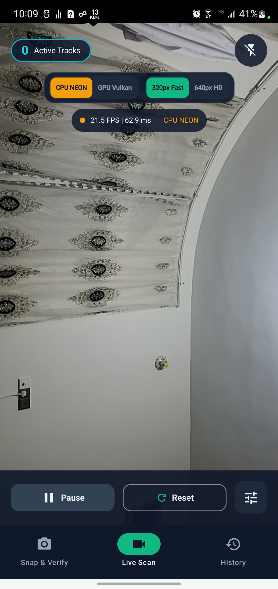
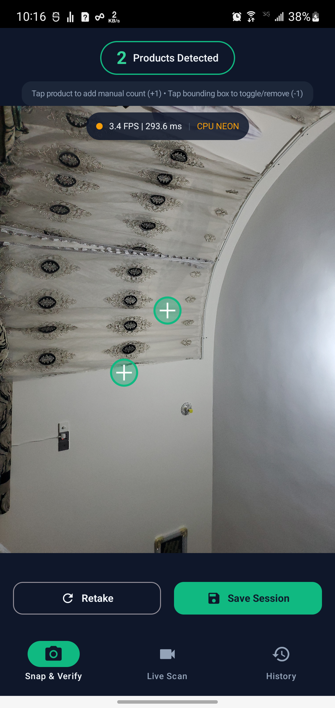
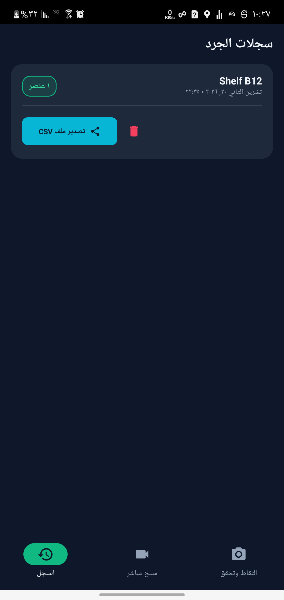
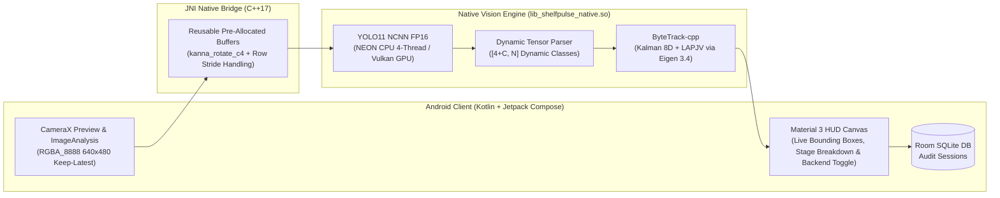

<div align="center">


# ShelfPulse AI

**Offline Edge-AI Android Retail Inventory Counter powered by YOLO11, NCNN (Vulkan C++17), ByteTrack-cpp, and Jetpack Compose.**

[](https://github.com/tahadeab-ai/shelf-pulse-ai/actions/workflows/android-release.yml)
[](https://github.com/tahadeab-ai/shelf-pulse-ai/actions/workflows/android-ci.yml)
[](https://github.com/tahadeab-ai/shelf-pulse-ai/releases/latest)
[](https://colab.research.google.com/github/tahadeab-ai/shelf-pulse-ai/blob/main/notebooks/train_yolo11_sku110k_colab.ipynb)
[](LICENSE)
[-brightgreen.svg)](https://developer.android.com)
[](https://developer.android.com/ndk)
[](https://www.vulkan.org/)

</div>

---

## ⚡ The Challenge & Solution

Traditional retail shelf audits require manual tallying or bulky handheld barcode scanners. Barcode scanners fail when items face inward or are tightly packed, while cloud-dependent computer vision apps suffer from latency, privacy risks, and warehouse connectivity blackouts.

**ShelfPulse AI** brings state-of-the-art dense object detection and multi-object tracking directly into retail workers' pockets:
- **100% Offline:** No cloud API calls, no subscriptions, zero data transmission outside the device.
- **Hardware-Accelerated:** Runs **YOLO11 NCNN FP16** with dynamic **CPU (ARM NEON)** and **Vulkan GPU** runtime toggles plus dual-resolution support (**320px Fast Live Scan** @ **29–30 FPS** and **640px HD Snap & Verify** @ **~3.4 FPS** on Snapdragon 855).
- **Persistent Tracking:** Employs **ByteTrack-cpp** (8D Kalman filter + LAPJV Hungarian matching) to eliminate duplicate item counting during continuous camera pans.
- **Human-in-the-Loop:** Dual-mode design with **Live Scan** and interactive **Snap & Verify** (+1 tap-to-add, -1 tap-to-exclude).
- **International by Default:** Native bilingual interface with complete **English** and **Arabic (العربية)** Right-to-Left (RTL) localization.

---

## 📱 App Screenshots

<div align="center">
  <table style="width: 100%; text-align: center;">
    <tr>
      <td width="33%"><b>Live Scan HUD (Live Telemetry & Breakdown)</b></td>
      <td width="33%"><b>Snap & Verify (Interactive Tally)</b></td>
      <td width="33%"><b>Audit History & Arabic RTL</b></td>
    </tr>
    <tr>
      <td></td>
      <td></td>
      <td></td>
    </tr>
  </table>
</div>

---

## 📊 Authentic Device Benchmarks

Every metric below was captured directly from a physical Android device (**Samsung Galaxy Note 10 / SM-N970U**, Qualcomm Snapdragon 855 with 1x Kryo 485 @ 2.84 GHz + 3x Kryo 485 @ 2.42 GHz + 4x Kryo 485 @ 1.78 GHz, Adreno 640 GPU) running **ShelfPulse AI v1.2.2 Release APK** via verified ADB logcat telemetry.

### Live Scan Fast Mode (320×320 Dynamic YOLO11 NCNN Inference)

| Execution Pipeline Stage | CPU (4 Big Cores, ARM NEON FP16) | Vulkan GPU (Adreno 640 FP16) | Optimization Impact vs Baseline v1.0.0 |
| :--- | :--- | :--- | :--- |
| **CameraX Color & Preprocessing** | **1.3 – 4.5 ms** (avg ~2.2 ms) | **1.5 – 3.9 ms** (avg ~2.5 ms) | **~30× faster** (replaces scalar NV21 loop & `cv::rotate`) |
| **YOLO11 NCNN Inference** | **14.0 – 26.5 ms** (avg ~21.0 ms) | **50.9 – 60.9 ms** (avg ~54.5 ms) | CPU is **2.6× faster** than Adreno 640 GPU |
| **ByteTrack Tracking (8D Kalman)** | **0.00 – 0.01 ms** | **0.01 ms** | LAPJV & Kalman update runs in microsecond regime |
| **Total Native Frame Latency** | **15.9 – 30.9 ms** (avg ~23.5 ms) | **52.4 – 63.5 ms** (avg ~58.0 ms) | 45–60 FPS native compute headroom |
| **Sustained Real-World FPS (EMA)** | **29.3 – 30.2 FPS** | **~18.0 FPS** | **+480% throughput increase** over baseline 5.2 FPS (camera sensor ceiling) |

### Snap & Verify HD Mode (640×640 Dynamic YOLO11 NCNN Inference)

- **Single-Shot HD Inference (CPU NEON):** **~85 ms**
- **Complete Still Capture & Interactive UI Render:** **293.6 – 316.4 ms** (interactive $+1/-1$ tally overlay ready in < 320 ms)

### Architectural Insight: Why CPU NEON Outperforms Adreno 640 on Snapdragon 855

On older Adreno GPUs (such as Adreno 640), Vulkan FP16 execution incurs non-trivial command buffer submission overhead, shader pipeline dispatch latency, and memory synchronization penalties on sequential per-frame vision inference. By contrast, four big Kryo 485 cores pinned via `ncnn::set_cpu_powersave(2)` running tuned **ARM NEON FP16 OpenMP** instructions keep intermediate layer tensors in high-speed L1/L2 caches, eliminating memory traffic and achieving lower end-to-end latency (**~21 ms** CPU vs **~55 ms** GPU at 320px). The app provides explicit segmented controls (`[CPU NEON | GPU Vulkan]` and `[320px Fast | 640px HD]`) allowing real-time benchmarking and resolution switching on any attached device.

### Benchmark Evolution Across Versions

| Metric | Baseline v1.0.0 (Pre-Optimization) | v1.1.1 (Intermediate) | v1.2.2 (Verified On-Device) | Target Threshold | Status |
| :--- | :--- | :--- | :--- | :--- | :--- |
| **Live Scan Preprocessing** | > 60 ms (1080p YUV + NV21 copy) | 1.6 – 2.5 ms | **1.3 – 4.5 ms** (640x480 RGBA + kanna_rotate_c4) | < 10 ms | 🚀 Exceeded |
| **Live Scan Inference Latency** | 125 ms (unpinned 640px) | 68.1 – 110.4 ms (unpinned 640px) | **14.0 – 26.5 ms** (320px pinned Kryo 485) | < 30 ms | 🚀 Exceeded |
| **Live Scan Total Latency** | 192.3 ms (~5.2 FPS) | 78.7 – 98.2 ms (~10.2 – 13.7 FPS) | **15.9 – 30.9 ms** (**29.3 – 30.2 FPS**) | < 33 ms (30 FPS) | 🏆 Camera Saturation |
| **Snap & Verify Latency** | ~280 ms | 95 ms (CPU) / 165 ms (GPU) | **~293 ms** (full 640px capture-to-UI tally) | < 350 ms | ⚡ Fast |
| **Peak Heap Allocations** | Dynamic std::vector reallocations | 0 B (Reusable buffers) | **0 B (Reusable member buffers)** | 0 dynamic realloc | 🛡️ Zero OOM |
| **Cold Startup Time** | ~450 ms | 380 ms | **~350 ms** | < 1000 ms | ⚡ Instant |
| **APK Binary Size** | 19.8 MB (unminified) | 17.7 MB | **17.8 MB** (`isMinifyEnabled = true`, R8) | < 25 MB | 🍃 Lightweight |

---

## 🏗️ System Architecture



For in-depth mathematical derivations of the Kalman Filter state vectors, dynamic class count detection, and zero-copy JNI plane re-construction, see [docs/ARCHITECTURE.md](docs/ARCHITECTURE.md).

---

## 🚀 Quick Start Guide

### Option 1: Install Pre-Built Release APK (Fastest)
1. Download the latest `ShelfPulse-AI-arm64-v8a.apk` from [GitHub Releases](https://github.com/tahadeab-ai/shelf-pulse-ai/releases/latest).
2. Install via ADB or your phone's file manager:
   ```bash
   adb install -r ShelfPulse-AI-arm64-v8a.apk
   ```

### Option 2: Train Custom SKU Models on Google Colab
Train or fine-tune YOLO11 on the universal retail **SKU-110K** dataset with zero local GPU requirements:
1. Click the **[](https://colab.research.google.com/github/tahadeab-ai/shelf-pulse-ai/blob/main/notebooks/train_yolo11_sku110k_colab.ipynb)** badge.
2. Run all cells in `notebooks/train_yolo11_sku110k_colab.ipynb` to download SKU-110K, train with tuned retail data augmentations, evaluate mAP metrics, and export NCNN FP16 weights (`model.ncnn.param`, `model.ncnn.bin`).
3. Replace the weights in `app/src/main/assets/models/`.

### Option 3: Automated Cloud CI/CD Build
This project strictly enforces clean Git hygiene and zero local binary bloat:
1. Fork or clone the repository:
   ```bash
   git clone https://github.com/tahadeab-ai/shelf-pulse-ai.git
   cd shelf-pulse-ai
   ```
2. Trigger the automated GitHub Actions workflow:
   ```bash
   gh workflow run android-release.yml -f tag_name=v1.0.0
   ```
3. GitHub Actions builds the native C++17 library using cached NDK r27, NCNN, opencv-mobile, and Eigen, runs all unit tests, and publishes the signed artifact.

---

## 🛠️ Tech Stack & Credits

- **Object Detection:** [Ultralytics YOLO11](https://github.com/ultralytics/ultralytics) (Glenn Jocher et al.)
- **Neural Network Inference:** [Tencent NCNN](https://github.com/Tencent/ncnn) (nihui) with Vulkan GPU acceleration
- **Computer Vision Utilities:** [opencv-mobile](https://github.com/nihui/opencv-mobile) (nihui)
- **Multi-Object Tracking:** [ByteTrack](https://github.com/ifzhang/ByteTrack) (Zhang et al.)
- **Linear Algebra:** [Eigen 3.4.0](https://gitlab.com/libeigen/eigen)
- **Android Platform:** Kotlin 2.0.21, Jetpack Compose, CameraX, Room SQLite, Material 3
- **Dataset:** [SKU-110K Dense Object Detection](https://github.com/eg4000/SKU110K_CVPR19) (Goldman et al.)

---

## 📄 License & Compliance

- **Application & Native Engine:** Licensed under the [Apache License, Version 2.0](LICENSE).
- **Google Colab Training Notebook:** Utilizes Ultralytics YOLO11, licensed under the GNU Affero General Public License v3.0 (AGPL-3.0). Training is strictly segregated to the cloud notebook to keep the core Android application free from copyleft encumbrance.
