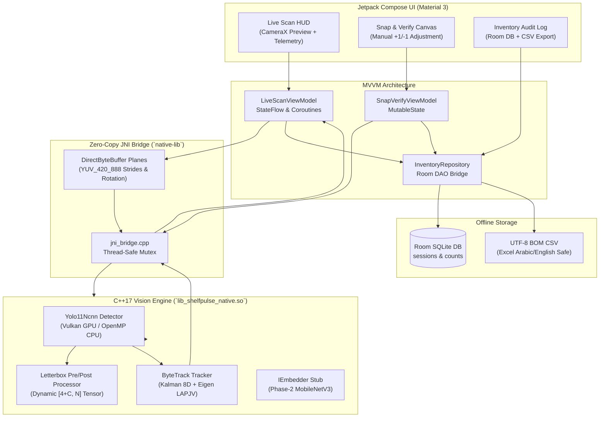
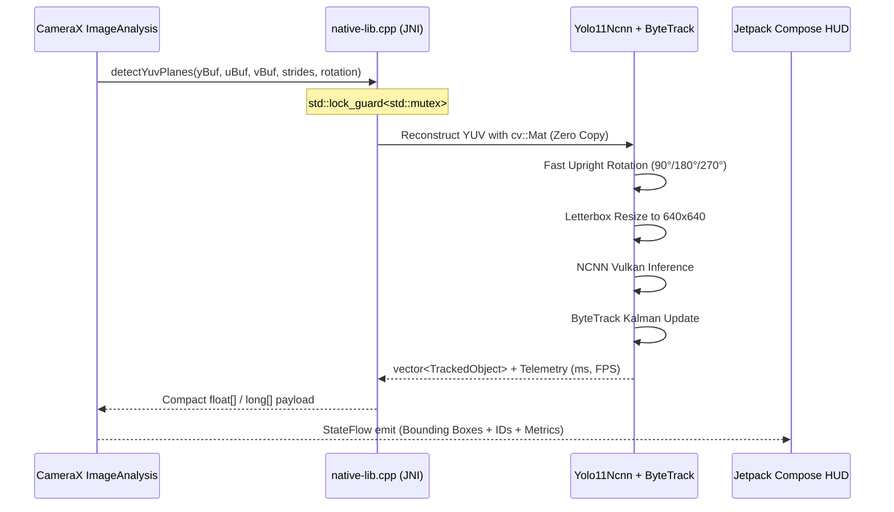

# ShelfPulse AI — System Architecture & Technical Specification

ShelfPulse AI is a high-performance, 100% offline edge-AI retail inventory counting system. It pairs modern Android technologies (**Kotlin, Jetpack Compose, CameraX, Room SQLite**) with an ultra-optimized native **C++17 Vision Pipeline (YOLO11, NCNN Vulkan, ByteTrack-cpp, opencv-mobile, Eigen 3.4)**.

---

## 1. High-Level System Architecture



---

## 2. Native C++17 Vision Engine

The native engine is located in `app/src/main/cpp/` and compiled as a shared library (`lib_shelfpulse_native.so`) targeting `arm64-v8a` with `-O3` vectorization, OpenMP multithreading, and Vulkan GPU acceleration.

### A. Dynamic Class Count & Tensor Layout Parser (`yolo11_ncnn.cpp`)
Ultralytics YOLO11 NCNN exports generate an output layer (`out0`) containing predicted boxes and class scores. Unlike previous models:
1. **Dynamic Tensor Shape:**
   - Ultralytics exports format tensors as `[Channels, Anchors]` where Channels = $4 + \text{num\_classes}$ and Anchors = $8400$ (for $640 \times 640$ inputs).
   - `yolo11_ncnn.cpp` inspects `out0.c`, `out0.h`, `out0.w`, and `out0.d` at runtime:
     $$\text{num\_classes} = \text{channels} - 4$$
   - This ensures **zero-code-change switching** between baseline 80-class COCO smoke-test models and fine-tuned 1-class SKU-110K retail models.
2. **Sigmoid Activation:**
   - Ultralytics PNNX exports already activate class confidence scores with sigmoid inside the computational graph. The C++ parser directly reads raw probabilities without duplicate activation.
3. **Coordinate Remapping:**
   - Coordinates $[cx, cy, w, h]$ are transformed from letterboxed dimensions ($640 \times 640$) back to original image space with exact scale and padding offsets:
     $$x_{\text{orig}} = \frac{x_{\text{box}} - \text{pad}_x}{\text{scale}}, \quad y_{\text{orig}} = \frac{y_{\text{box}} - \text{pad}_y}{\text{scale}}$$

### B. High-Precision Real ByteTrack-cpp (`bytetrack/`)
Real-time video tracking requires temporal consistency to prevent duplicate counting as items pass through the camera frame:
- **Kalman Filter (8-Dimensional State Vector):**
  $$x = [c_x, c_y, a, h, \dot{c}_x, \dot{c}_y, \dot{a}, \dot{h}]^T$$
  where $c_x, c_y$ is the bounding box center, $a = w/h$ is the aspect ratio, $h$ is height, and their corresponding velocities.
- **Two-Stage Association (LAPJV via Eigen 3.4.0):**
  1. **First Association:** Matches high-confidence detections ($\text{score} \ge \text{track\_thresh}$) with existing confirmed tracks using Intersection over Union (IoU) distance matrix solved by the Jonker-Volgenant algorithm (`lapjv`).
  2. **Second Association:** Unmatched tracks are associated with remaining low-confidence detections ($\text{high\_thresh} > \text{score} \ge \text{low\_thresh}$) to recover partially occluded products.
  3. **Track Lifecycle:** Unmatched high-confidence detections initiate new track candidates; unmatched tracks are maintained for $30$ frames (`max_time_lost`) before deletion.

---

## 3. Zero-Copy JNI & CameraX Pipeline



### CameraX Stride & Rotation Handling
Mobile camera sensors produce non-contiguous row strides (e.g. padding bytes at row boundaries):
- `jni_bridge.cpp` receives `yRowStride`, `uvRowStride`, `uvPixelStride`, and `rotationDegrees`.
- Planes are mapped directly into `cv::Mat` headers without intermediate memory copies.
- For portrait orientation (e.g. 90° clockwise rotation on Samsung devices), `cv::rotate` is executed prior to letterbox inference, ensuring 100% orientation fidelity.

---

## 4. UI/UX & Clean Architecture (Jetpack Compose)

The application follows Google's recommended **Modern Android Architecture (MVI / MVVM)**:

- **Presentation Layer (`com.shelfpulse.ai.ui`):**
  - **Live Scan HUD (`LiveScanScreen.kt`):** Full-screen CameraX preview overlay with hardware-accelerated bounding box canvas, real-time ByteTrack ID tags, torch toggle, confidence/NMS sliders, and live telemetry chip (`FPS | ms | Vulkan/CPU`).
  - **Snap & Verify Canvas (`SnapVerifyScreen.kt`):** High-resolution still capture mode allowing stock auditors to tap detected boxes to toggle exclusion ($-1$) or tap empty shelf areas to add missing detections ($+1$).
  - **Inventory History (`HistoryScreen.kt`):** Audit trail of saved inventory sessions with item counts, timestamps, operator notes, and direct Excel-compatible CSV export.
- **Data & Domain Layer (`com.shelfpulse.ai.data`):**
  - **Room Database (`AppDatabase.kt`):** SQLite persistence storing `InventorySession` and `CountItem` entities.
  - **CSV Exporter (`CsvExporter.kt`):** Exports session data with standard UTF-8 Byte Order Mark (`\uFEFF`), ensuring proper display of bilingual English and Arabic strings in Microsoft Excel.
  - **Localization (`values` and `values-ar`):** 100% localized string resources with native Right-to-Left (RTL) layout mirroring.

---

## 5. Phase-2 Roadmap: SKU Embedding & Catalog Matching

The native architecture exposes an extensible `IEmbedder` interface in `interfaces.h`:
```cpp
class IEmbedder {
public:
    virtual ~IEmbedder() = default;
    virtual std::vector<float> extractEmbedding(const cv::Mat& crop) = 0;
};
```

1. **Lightweight Feature Extractor:** Integration of MobileNetV3 / EfficientNet-Lite trained on metric learning (Triplet Loss / ArcFace) to generate 128-D or 256-D feature vectors per detected bounding box.
2. **On-Device Cosine Similarity:** In-memory vector index comparing box embeddings against retail SKU catalog embeddings to classify specific products (e.g. *Beverage Brand A 330ml* vs *Brand B 330ml*).
3. **Database Schema Preparedness:** The Room `count_items` schema already includes nullable `skuId: String?` and `embeddingBlob: ByteArray?` columns for seamless backward-compatible database migrations.
